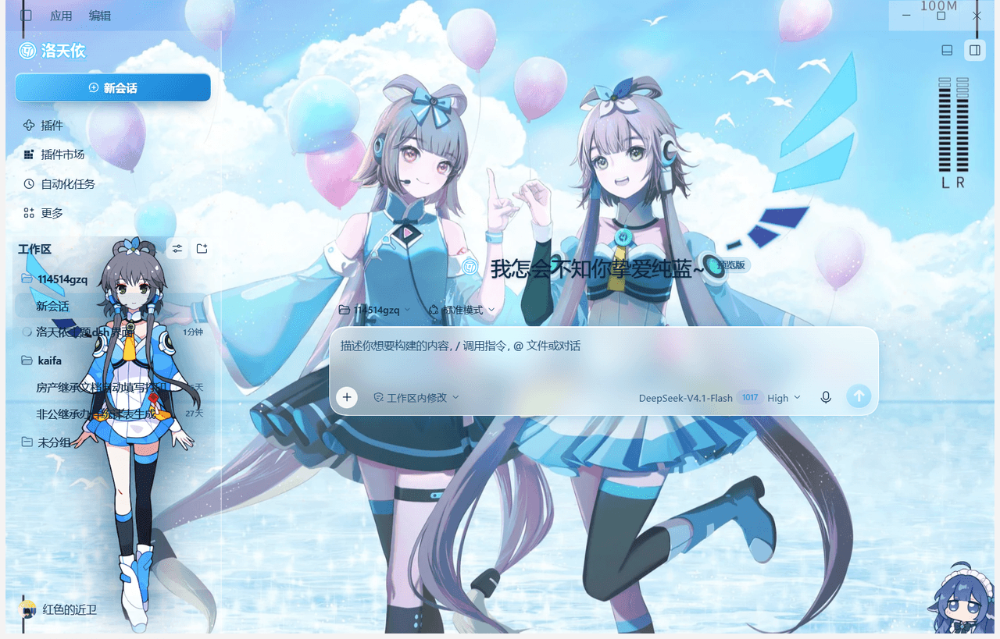

# 洛天依主题皮肤 · dsh-luotianyi-skin

> 给 [DeepSeek Harness](https://github.com/deepseek-ai) Web GUI 换一身「洛天依」：气球夏日壁纸铺满主界面、侧栏立绘、洛天依字标，配色统一走天依蓝 `#66CCFF`。



---

## 特性

- **主界面壁纸**：固定图层铺满窗口（`z-index:-1`），外壳面板全透明，文字转深墨色 + 极淡柔影，亮背景上依然清楚
- **侧栏立绘**：透明抠图立绘贴底居中，顶部渐隐融入面板；工区列表加了一层若隐若现的深蓝压板保证可读
- **洛天依 LOGO**：侧栏横向字标 / 折叠态圆形「洛」徽标 / 空会话标题旁的小徽标，全部来自同一份 SVG 资产
- **天依蓝交互**：新会话按钮、发送/停止按钮、滚动条、选中色、聚焦描边统一 `#66CCFF`
- **磨砂玻璃**：输入卡、`+`/`@` 菜单、弹窗、对话框带 `backdrop-filter: blur(16px)`
- **不挑宿主**：纯客户端插件，不改 DSH 本体；素材由宿主 `webServer` 走独立路由（`/skin-assets/luotianyi/*`），带 ETag + immutable 缓存
- **可回滚**：所有 DOM/CSS 改动都包在 `ctx.effect` 里，插件停用即完全还原

## 兼容性

- 面向 DeepSeek Harness 桌面版 / Web GUI 的客户端插件机制（含 `dsh.client` 声明、`window.__ModuleLoader__` 加载）
- **同一时间只能启用一个皮肤插件**；与本仓库同时启用的其他皮肤会互相覆盖

## 安装

### 方式 A：让 DSH 里的 AI 装（推荐）

把仓库放到一个固定位置（不要放桌面，容易误删），然后在 DSH 对话框里发：

```
安装本地插件 <这个文件夹的绝对路径>
```

DSH 会完成 `pnpm link` + profile 注册 + 启用。

### 方式 B：插件页手动添加

`插件` → 右上「+ 添加插件」→ 选择本地文件夹 → 确认开关为开启。

### 方式 C：命令行

本质是 profile 里一次 `pnpm link <绝对路径>` 并插入 `cordis.patch.yml` 条目。

> ⚠️ 不要手工编辑 profile 的 `package.json` / `cordis.patch.yml`，也不要在 profile 里直接跑 `pnpm install`——写坏一处（多一个 BOM、少一条 patch）DSH 就会启动失败。

### 装完没变化？

按 **Ctrl+F5** 强制刷新（客户端 bundle 有缓存），或在插件页把开关关掉再打开一次。

## 卸载 / 回滚

- 插件页关闭 `dsh-luotianyi-skin` 开关 → 立刻恢复默认外观
- 卸载 → 断开与本文件夹的链接（文件夹本身保留）
- 装了 `dsh-undo-savepoint` 的话，可直接恢复到安装前的快照

## 自定义

| 想改什么 | 改哪里 |
| --- | --- |
| 主界面壁纸 | `assets/runtime/wallpaper.webp`（建议宽 1800px，`cover` 铺满） |
| 侧栏立绘 | `assets/runtime/character2.webp`（透明背景，高约 1600px） |
| 侧栏字标 | `assets/runtime/logo-full.svg` |
| 圆形徽标 | `assets/runtime/logo-mark.svg`（`viewBox` 裁到 `0 0 178 200`） |
| 配色 / 圆角 / 毛玻璃 / 尺寸 | `lib/client.js` 里的 `buildCss()` |

替换素材后记得把 `lib/client.js` 顶部的缓存版本号递增（`const V = "?v=8"` → `"?v=9"`）再按 Ctrl+F5，否则浏览器会用旧图。

配色速查：天依蓝 `#66CCFF`、墨色正文 `#0d2a44` / `#12395a`、品牌色 `#1b86d4`。

## 目录结构

```
.
├─ package.json          # 插件清单（dsh.bundle.patch + dsh.client）
├─ cordis.patch.yml      # 注册进 profile 的 patch
├─ skin.json             # 皮肤元信息（id = luotianyi, bodyAttr = data-dsh-luotianyi）
├─ lib/index.js          # 宿主侧：/skin-assets/luotianyi/* 白名单 + ETag
├─ lib/client.js         # 客户端侧：注入 CSS + 壁纸层 + 对比度扫描
├─ assets/
│  ├─ plugin-icon.svg
│  └─ runtime/{wallpaper.webp, character2.webp, logo-full.svg, logo-mark.svg}
├─ locale/{zh,en}.json   # 插件市场的标题与描述
└─ docs/preview.png      # 效果截图
```

## 实现要点

- 壁纸不是画在 `html/body` 背景上（那样会被宿主外壳的不透明表面盖住），而是注入一个 `position:fixed; z-index:-1` 的真实图层，并强制 `#root` / `[class*="frame"]` 透明
- 宿主有些卡片硬编码深色底，换浅色主题后会变成黑块；用节流的 `MutationObserver` 把「够黑、够大」的表面翻成白色玻璃，停用时逐元素还原
- 浅色文字压在照片上看不清：对比度地板会自动把亮度偏高、又没有深色背板的文字压成墨色，同时放行品牌色/按钮等需要保留颜色的元素
- 素材通过宿主 `webServer` 的 `prefix` 路由暴露，自带白名单与 ETag，不使用 `file://` 或内联 base64

## 许可

- **代码**：MIT，见 [LICENSE](LICENSE)
- **素材**：壁纸 / 立绘 / logo 来自洛天依官方素材，版权归**上海禾念信息科技有限公司**所有，本仓库仅作个人本地美化示例，请勿二次分发或商用
